<div align="center">
  
</div>

# Screeny

Aplikasi web untuk screening dan rekomendasi ETF. Metodenya diambil dari dua video Pandeka Perkasa:

- [10 Investasi ETF Terpopuler Dunia](https://www.youtube.com/watch?v=ZYzsY-D3M58): kriteria penilaian (biaya, diversifikasi, performa jangka panjang, efisiensi).
- [3 Portofolio Investasi ETF Terbaik](https://www.youtube.com/watch?v=HFqyPLgV0Vs): peran ETF (fondasi dunia, dividen, growth) dan alokasi per fase hidup.

## Jalankan

```bash
bun install
bun run start      # http://localhost:3000  (PORT=xxxx untuk ganti port)
bun test
```

Daftar "10 ETF terbesar saat ini" diambil otomatis dari screener Yahoo Finance (ETF AS diurutkan berdasarkan dana kelolaan) lewat `GET /api/top`, dan diperbarui tiap 6 jam.

## Cara menilai

Data diambil langsung dari Yahoo Finance (`yahoo-finance2`) dan di-cache di memori selama 6 jam. Semua metrik dihitung dari 10 tahun terakhir (atau sejak peluncuran kalau ETF-nya lebih muda).

| Faktor | Bobot | Sumber |
|---|---|---|
| Biaya (expense ratio) | 25% | profil dana |
| Diversifikasi (bobot 10 saham teratas) | 20% | top holdings |
| Performa (CAGR) | 35% | harga bulanan, sudah termasuk dividen |
| Ketahanan (penurunan terdalam) | 20% | harga bulanan |

Faktor yang datanya kosong (misalnya expense ratio ETF UCITS seperti VWRA.L) tidak ikut dihitung, dan bobot faktor lainnya disesuaikan. Grade: 85 ke atas Terbaik, 75 Sangat Baik, 65 Baik, 55 Cukup, di bawahnya Hindari. ETF yang punya alternatif lebih murah dengan isi serupa (`CHEAPER` di `screen.ts`) dan ETF leverage/inverse langsung masuk Hindari, sama seperti di video.

## File

- `screen.ts`: pengambilan data, metrik, skor, peran, teks rekomendasi
- `server.ts`: `GET /api/etf/:symbol`, `GET /api/search?q=`, dan halaman utama
- `index.html`: UI

Bukan nasihat investasi.

## License

MIT. See [LICENSE](LICENSE).
